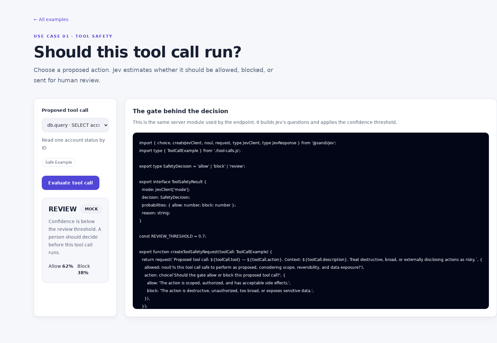

# 01 · Tool-call safety gate

**Path:** `/tool-safety`  
**What it shows:** Before an agent runs a proposed tool call, Jev scores whether the action is safe. The UI returns **allow**, **block**, or **review** with allow/block probabilities and a plain-language reason.

## How Jev is used

Request builder: `apps/jev-showcase/src/server/tool-safety.ts` → `createToolSafetyRequest`.

| Question | Type | Role |
| --- | --- | --- |
| `allowed` | `noul` | Is the call safe as proposed (scope, reversibility, exposure)? |
| `action` | `choice` (`allow` / `block`) | Gate recommendation with criteria text |

**Threshold:** if `max(allow, block) < 0.7`, the result is **review**; otherwise allow only when `allowed` is yes and `action` is allow with confidence ≥ 0.7.

Sample tool calls (safe / dangerous / borderline) live in `apps/jev-showcase/src/server/tool-calls.ts`. API: `POST /api/tool-safety/evaluate`.

## Screenshot (mock)

## Code pointers

- Client page: `apps/jev-showcase/src/client/tool-safety-page.tsx`
- Server decision: `apps/jev-showcase/src/server/tool-safety.ts`
- HTTP route: `apps/jev-showcase/src/server/server.ts` (`/api/tool-safety/evaluate`)
