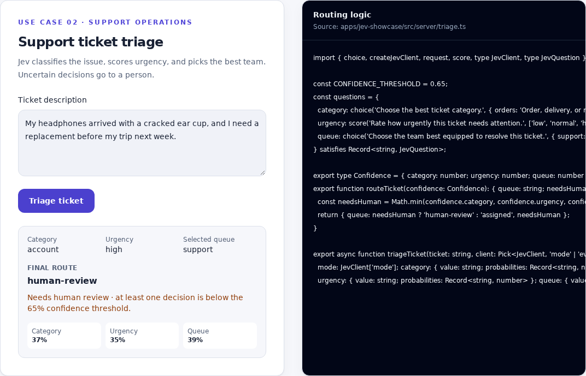

# 02 · Support ticket triage

**Path:** `/#support-triage` (home page section)  
**What it shows:** Jev classifies a support ticket into category, urgency, and queue. Low confidence on any axis routes to **human-review** instead of auto-assigning.

## How Jev is used

Logic: `apps/jev-showcase/src/server/triage.ts`.

| Question | Type | Criteria |
| --- | --- | --- |
| `category` | `choice` | `orders`, `billing`, `account` |
| `urgency` | `score` | `low` → `normal` → `high` |
| `queue` | `choice` | `support`, `billing`, `fulfillment` |

**Threshold:** if the minimum of the three top probabilities is below **65%**, `needsHuman` is true and `route` becomes `human-review`. Otherwise the selected queue name is used.

API: `POST /api/triage` with `{ ticket }`. The page also shows the triage source next to the form.

## Screenshot (mock)

## Code pointers

- UI section: `apps/jev-showcase/src/client/app.tsx` (`#support-triage`)
- Server: `apps/jev-showcase/src/server/triage.ts`
