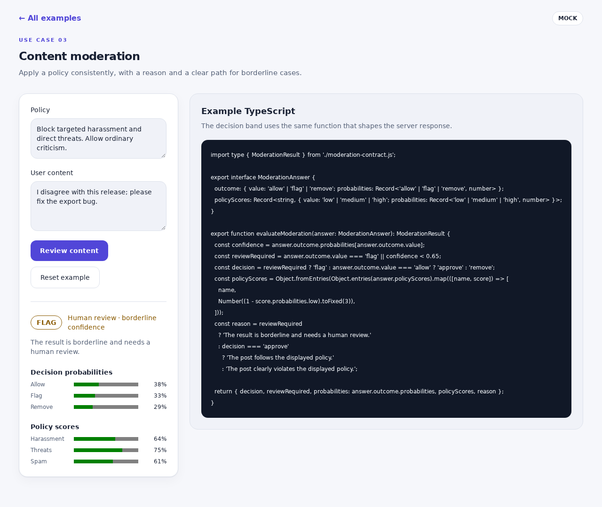

# 03 · Content moderation

**Path:** `/content-moderation`  
**What it shows:** Given a policy string and a user post, Jev proposes **allow / flag / remove**, plus harassment / threats / spam severity scores. Borderline outcomes become a human **flag**.

## How Jev is used

Request: `apps/jev-showcase/src/server/moderation.ts` → `createModerationRequest`.  
Post-processing: `apps/jev-showcase/src/moderation-core.ts` → `evaluateModeration`.

| Question | Type | Role |
| --- | --- | --- |
| `outcome` | `choice` | `allow` / `flag` / `remove` |
| `harassment` | `score` | `low` / `medium` / `high` |
| `threats` | `score` | same levels |
| `spam` | `score` | same levels |

**Threshold:** if the chosen outcome is `flag`, or the probability of the chosen outcome is **&lt; 0.65**, the UI decision becomes **flag** with `reviewRequired`. Otherwise allow maps to **approve** and remove maps to **remove**.

API: moderation route on the showcase server (see `server.ts`). Content length 1–5000; policy 1–500.

## Screenshot (mock)

## Code pointers

- Client: `apps/jev-showcase/src/client/moderation.tsx`
- Server + request: `apps/jev-showcase/src/server/moderation.ts`
- Decision mapping: `apps/jev-showcase/src/moderation-core.ts`
