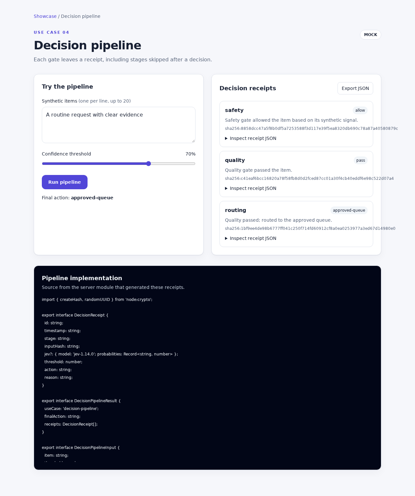

# 04 · Decision receipts pipeline

**Path:** `/decision-pipeline`  
**What it shows:** A multi-stage pipeline (safety → quality → routing) that logs a **receipt** for every stage, including **skipped** stages with a reason. Final action is `block`, `review`, or `approved-queue`.

## How decisions work

Implementation: `apps/jev-showcase/src/server/decision-pipeline.ts`.

This demo uses **synthetic local signals** keyed off the item text (e.g. words like `block` / `unsafe` / `ambiguous`) plus a configurable confidence threshold (0–1). Receipts record stage, input hash, optional probability map labeled with model `jev-1.14.0`, threshold, action, and reason. Skips are first-class — for example, quality and routing are skipped when safety blocks.

You can submit multiple items (one per line, up to 20). API: decision-pipeline route in `server.ts`.

## Screenshot (mock)

## Code pointers

- Client: `apps/jev-showcase/src/client/decision-pipeline-page.tsx`
- Pipeline + receipts: `apps/jev-showcase/src/server/decision-pipeline.ts`
