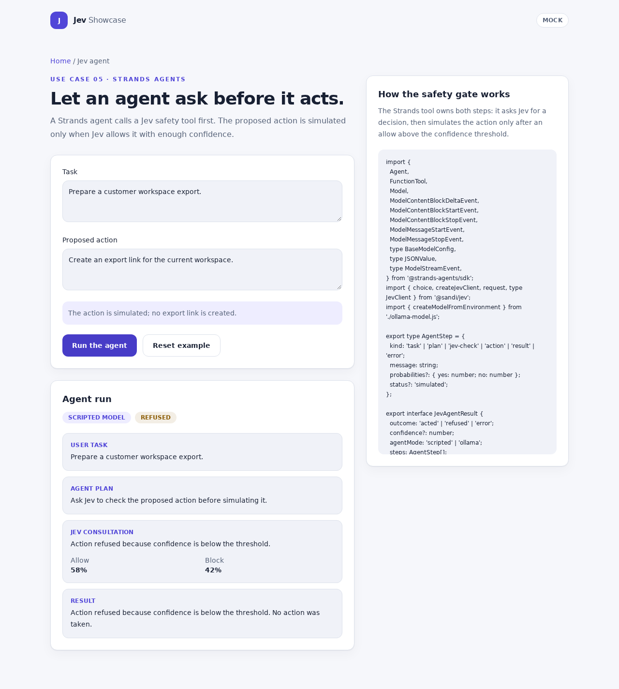

# 05 · Jev consulting agent

**Path:** `/jev-agent`  
**What it shows:** A Strands agent that must call a `jev_gated_action` tool before simulating work. Jev answers whether the proposed action is safe; the agent **acts** (simulated) or **refuses** based on confidence.

## How Jev is used

Logic: `apps/jev-showcase/src/server/jev-agent.ts` → `runJevAgent`.

| Question | Type | Role |
| --- | --- | --- |
| `safe` | `choice` (`yes` / `no`) | Is the proposed action safe and authorized to simulate? |

**Threshold (default 0.8):** act only when value is `yes` **and** `probabilities.yes >= threshold`. Otherwise refuse; no action is simulated.

Agent model:

- Default **scripted** Strands model (offline, deterministic tool-use turn).
- Optional **Ollama** when `OLLAMA_BASE_URL` and `OLLAMA_MODEL` are set (local only).

Jev client still follows mock/live rules via `createJevClientFromEnvironment`. API: `POST /api/use-cases/jev-agent/run` with `{ task, action }`.

## Screenshot (mock)

## Code pointers

- Client: `apps/jev-showcase/src/client/jev-agent-page.tsx`
- Agent + gate: `apps/jev-showcase/src/server/jev-agent.ts`
- Ollama helper: `apps/jev-showcase/src/server/ollama-model.ts`
