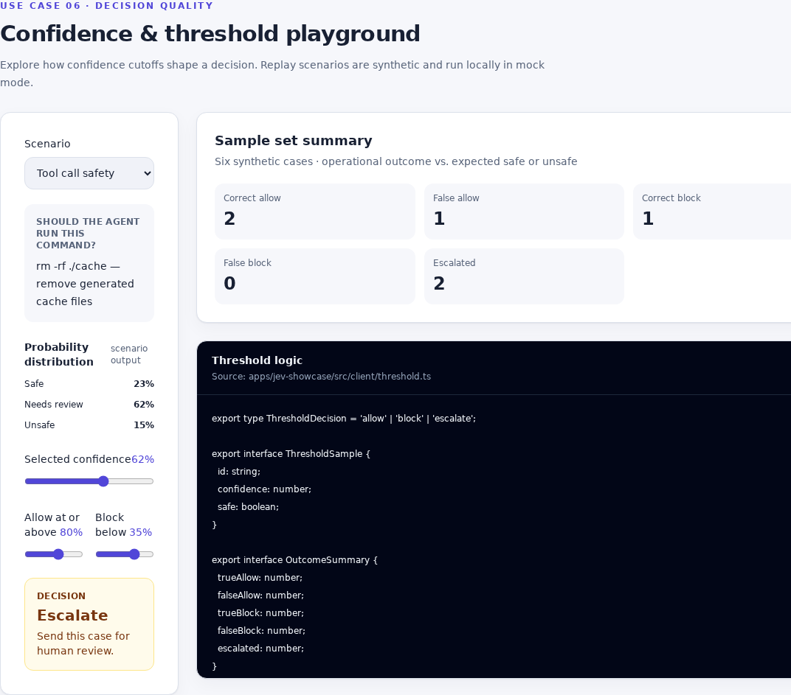

# 06 · Confidence & threshold playground

**Path:** `/#confidence-playground` (home page section)  
**What it shows:** Purely client-side exploration of allow / block / escalate bands. Scenario probability distributions are **synthetic** and fixed; sliders change thresholds while evidence stays put. A sample set summarizes true/false allow/block and escalations.

## How decisions work

No live Jev call on this page. Logic: `apps/jev-showcase/src/client/threshold.ts`.

- `decideWithThresholds(confidence, allowThreshold, blockThreshold)` → `allow` | `block` | `escalate`
- Require `allowThreshold > blockThreshold`
- Built-in scenarios: tool-safety, message moderation, account access
- Sample outcomes: `summarizeOutcomes(thresholdSamples, …)`

Use this to teach threshold tradeoffs before talking about production Jev gates.

## Screenshot (mock)

## Code pointers

- UI: `apps/jev-showcase/src/client/app.tsx` (`#confidence-playground`)
- Threshold helpers: `apps/jev-showcase/src/client/threshold.ts`
