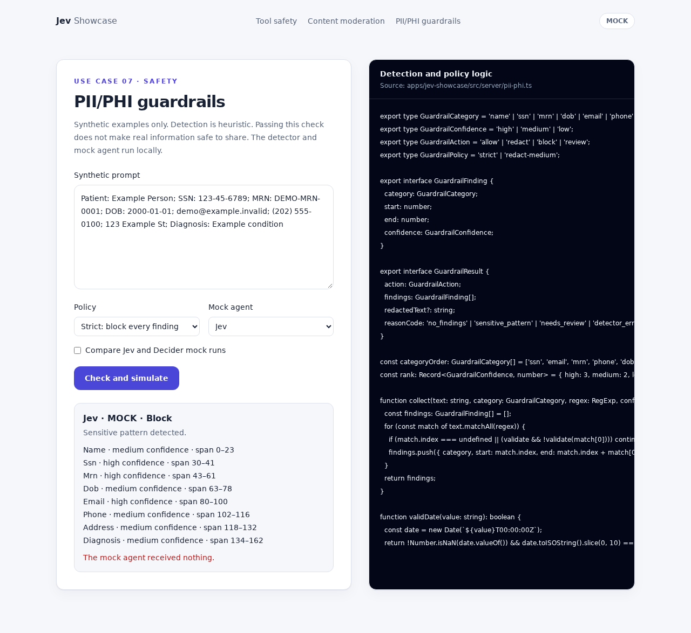

# 07 · PII/PHI guardrails

**Path:** `/pii-phi-guardrails`  
**What it shows:** Detect synthetic sensitive patterns (names, SSN, MRN, DOB, email, phone, address, diagnosis) in a prompt, then **allow**, **redact**, **block**, or **review** before a mock agent would see the text.

## How decisions work

This use case does **not** call the TypeSafe Jev API for detection. Pattern finding and policy are local regex/heuristics in `apps/jev-showcase/src/server/pii-phi.ts`. After the guardrail decision, a **mock agent** path (`jev` or `decider`) may receive the allowed/redacted text — or nothing when blocked. An optional compare mode runs both mock engines side by side.

| Policy | Behavior |
| --- | --- |
| `strict` | High or medium findings → **block** |
| `redact-medium` | High → **block**; medium-only → **redact** with `[REDACTED:CATEGORY]` spans |

Low-confidence findings → **review**. No findings → **allow**. Inputs are synthetic demo text only; never paste real patient or customer data into the public repo or screenshots.

Architecture note: `docs/architecture/use-case-7-pii-phi-guardrails.md`.

## Screenshot (mock)

## Code pointers

- Client: `apps/jev-showcase/src/client/pii-phi-guardrails.tsx`
- Detector + policy: `apps/jev-showcase/src/server/pii-phi.ts`
